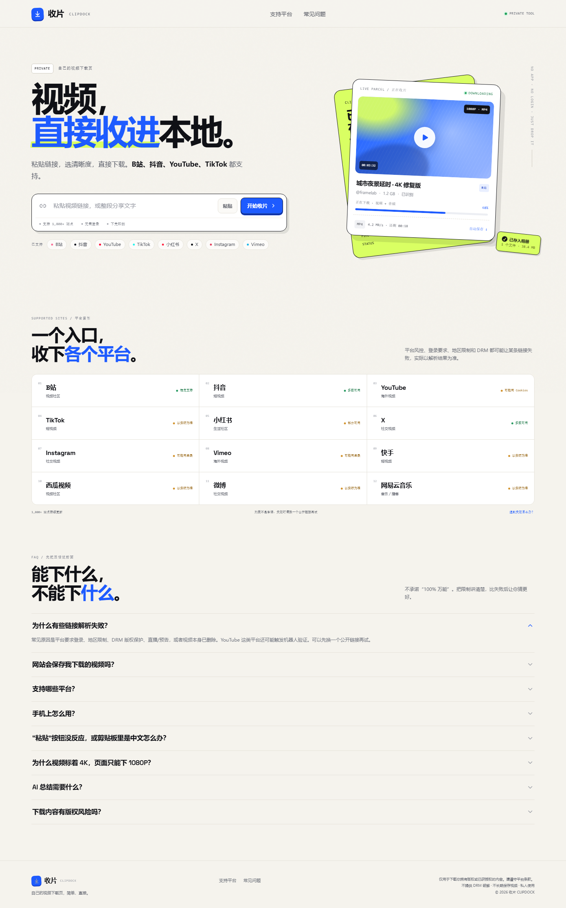
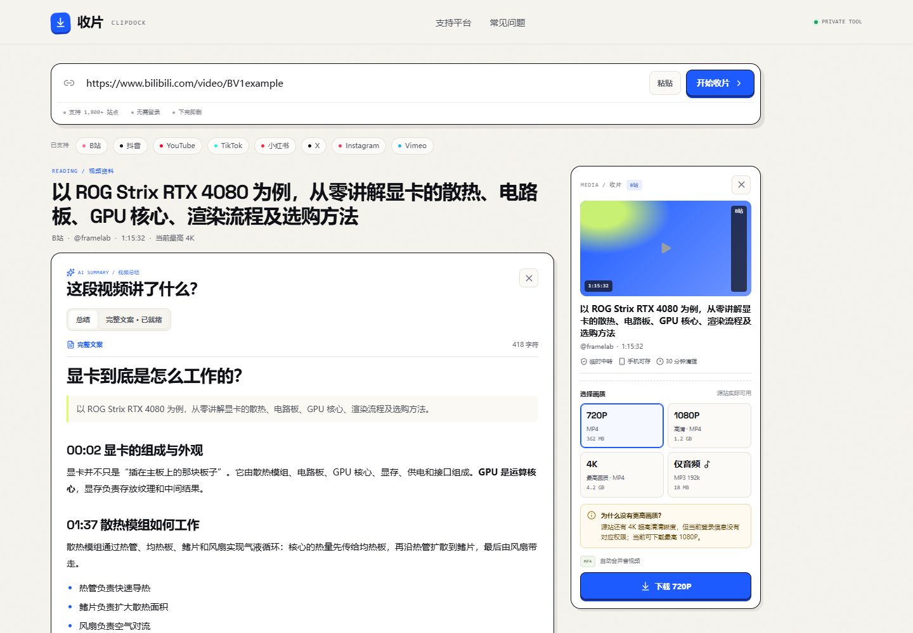
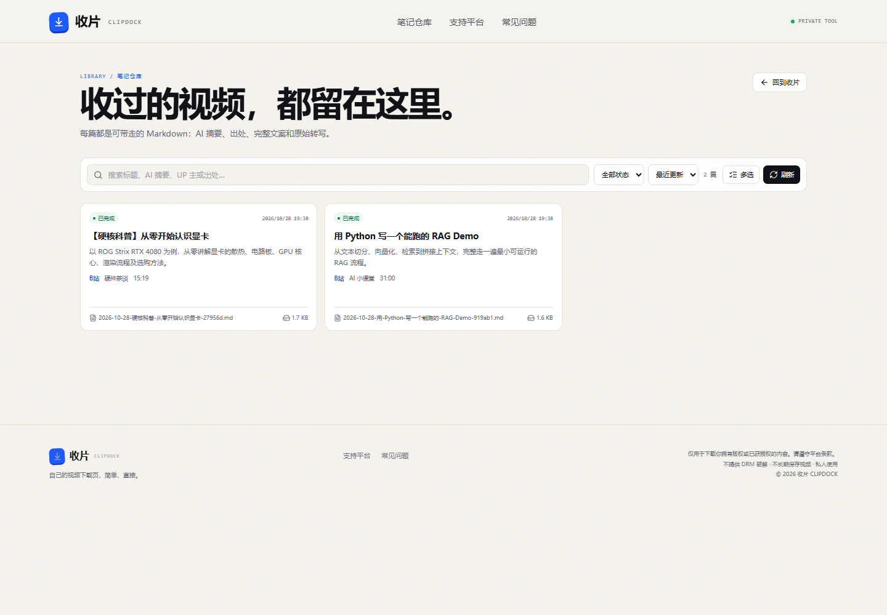

# 收片 CLIPDOCK

一个给自己用的视频下载页：粘贴链接，选择清晰度，直接保存。无登录、无付费、无广告，也不长期保存视频。







## 功能

- 单链接解析：标题、封面、作者、时长、平台、画质与预估大小
- 画质选择：720P / 1080P / 最高可用画质 / 仅音频
- 剪贴板容错：从中文标题、表情和分享文案中自动提取视频链接
- 真实下载进度、速度、ETA，音视频自动合并
- 下载中暂停 / 继续 / 取消，暂停保留分片续传
- AI 视频总结：字幕优先，无字幕时本地 Whisper 转写
- AI 完整文案：把转写整理成带标题、段落和列表的 Markdown 文章，可复制 / 下载
- 结果页阅读模式：左侧总结与文案，右侧 300px 媒体栏放封面、画质、下载进度
- **笔记仓库**：每次 AI 总结自动生成 Markdown，带 AI 摘要、出处、完整文案和原始转写
- 仓库支持搜索、预览、多选批量下载 zip、批量删除到回收站
- SQLite 仅作可重建的元数据索引；Markdown 仍是唯一正文来源
- 转写/总结/整理稿缓存，二次打开秒出
- 手机端适配，临时文件 30 分钟清理
- 无账号、无支付模块

## 快速启动

需要 Python 3.13+、Node.js 20+。Windows 下直接运行：

```powershell
.\start.ps1
```

或手动启动：

```powershell
python -m venv .venv
.\.venv\Scripts\python.exe -m pip install -r requirements.txt
cd frontend
npm install
npm run build
cd ..
.\.venv\Scripts\python.exe -m uvicorn backend.app:app --host 0.0.0.0 --port 8000
```

打开 <http://127.0.0.1:8000>。手机访问时使用电脑的局域网 IP，例如 `http://192.168.x.x:8000`。

## 项目文档

- [需求规格说明书](docs/REQUIREMENTS.md)
- [方案设计说明书](docs/DESIGN.md)
- [产品与技术方案](docs/PROPOSAL.md)
- [本次优化说明](docs/04-本次优化.md)
- [文档索引](docs/README.md)

## 技术栈

| 层 | 方案 |
| --- | --- |
| 前端 | React 19 + Vite 8 + TypeScript，原生 CSS |
| 后端 | Python 3.13 + FastAPI + Uvicorn |
| 下载 | yt-dlp Python API |
| 合并/转码 | imageio-ffmpeg 自带 ffmpeg |
| AI 转写 | faster-whisper（本地 CPU） |
| AI 总结 | OpenAI 兼容接口 |
| 状态 | 内存 Job Store / Summary Store + 临时目录 |

## AI 视频总结与完整文案

结果页左侧是阅读区，点「AI 视频总结」后：

1. 平台有字幕时直接读取字幕，不下载视频。
2. 没有字幕时只下载音频流（不先转 MP3），用本地 `faster-whisper` 转写。
3. 把字幕/转写文本交给大模型，返回一句话总结、核心要点、章节、引用和关键词。
4. 总结完成后，后台继续用同一份转写生成「完整文案」：
   - 按内容分节，有标题、段落、列表和引用；
   - 删除口头禅与重复，补全标点，保留事实、数字和术语；
   - 在「完整文案」tab 里阅读、复制或下载 `.md`。

转写、总结和整理稿都会缓存到 `data/cache/`。同一链接第二次打开时直接命中缓存，不再重复下载/转写/调用模型。

配置模型：复制 `.env.example` 为 `.env`，至少填写：

```dotenv
SUMMARY_API_BASE=https://api.deepseek.com/v1
SUMMARY_API_KEY=your-api-key
SUMMARY_MODEL=deepseek-flash
```

也可以直接设置进程环境变量。重启服务后打开 `/api/health`，确认：

- `summaryConfigured: true`
- `articleEnabled: true`
- `whisperAvailable: true`

未配置 Key 时总结接口返回 503，不影响下载。默认 Whisper 模型是 `small`，第一次转写会下载模型；长视频在 CPU 上会慢一些，可通过 `WHISPER_MODEL` 调整。AI 整理稿会额外消耗一次（长视频为分段多次）模型调用；不想要可在 `.env` 设 `SUMMARY_ARTICLE_ENABLED=false`。

### 速度说明

总结慢通常不是单一原因：

- **无字幕视频**：本地 Whisper 转写是大头，10 分钟视频在 CPU 上跑几分钟很常见；第一次还会下载模型。
- **有字幕视频**：一般 3–15 秒出总结；如果仍慢，多半是模型调用或长转写分段。
- **长转写**：超过 3 万字符会先分段压缩，再生成最终总结，全部串行。

已做的优化：

- 有字幕绝不下载音频；无字幕只下载 bestaudio，直接解码，不再先转 MP3。
- 转写、总结、整理稿按 URL + 模型 + prompt 版本缓存，第二次打开秒出。
- 默认模型 `deepseek-flash`，比旧 `deepseek-chat` 更快、更便宜。
- 总结先返回，完整文案在后台生成，不阻塞总结阅读。
- UI 显示字幕 / 音频 / 转写 / 总结阶段；长任务可以留在页面等待。
- `deepseek-flash` 会使用 reasoning token；总结/文案已加大输出预算，JSON 异常会自动修复一次，仍失败会降级为简要总结而不是直接报错。

## 笔记仓库

每次 AI 总结会自动创建一篇 Markdown，放在 `data/library/`：

```text
data/library/2026-10-28-从零开始认识显卡-8f3a.md
```

文件带 YAML frontmatter（标题、AI 摘要、出处、平台、UP 主、时长、状态）和正文（AI 摘要、核心要点、章节、完整文案、可折叠原始转写）。文件名本身也包含标题，脱离应用后仍然可读。

- 生成中写 `.drafts/<id>.md`，完成后原子改名成正式文件。
- 同一视频按 `source_url` 去重；重新生成覆盖同一篇。
- SQLite（`data/library.sqlite3`）只存列表/搜索/状态，删掉后重启会扫描 Markdown 重建。
- 仓库页面支持搜索、状态筛选、预览、多选下载 zip、多选删除到回收站。
- 批量下载的 zip 里包含所有 `.md` 和一份 `index.md` 清单。

## 4K / 高清画质

页面会展示源站实际返回的画质。有些平台把 4K、HDR 或高帧率作为登录/会员权益；服务端没有对应权限时，只能拿到平台允许的 1080P，页面会说明缺失的清晰度，不会伪造 4K。

需要 4K 时，可以让服务端使用一个有权限的账号：

1. 从浏览器导出 Netscape 格式的 `cookies.txt`。
2. 设置 `YTDLP_COOKIES` 后重启。
3. 打开 `/api/health` 确认 `cookiesConfigured: true`。
4. 重新解析视频。

`cookies.txt` 等同于登录凭据，不要提交到 Git 或发给别人；`.gitignore` 已忽略。

## 环境变量

| 变量 | 默认值 | 说明 |
| --- | --- | --- |
| `YTDLP_COOKIES` | 空 | Netscape `cookies.txt` 路径 |
| `YTDLP_PROXY` | 空 | 下载代理，例如 `http://127.0.0.1:7890` |
| `SUMMARY_API_BASE` | `https://api.deepseek.com/v1` | OpenAI 兼容接口地址 |
| `SUMMARY_API_KEY` | 空 | 总结模型密钥；为空时关闭总结 |
| `SUMMARY_MODEL` | `deepseek-flash` | 总结/整理稿模型名称 |
| `SUMMARY_MAX_DURATION_SECONDS` | `2700` | 总结视频最大时长 |
| `SUMMARY_MAX_CHARS` | `30000` | 送入总结模型的转写文本上限 |
| `SUMMARY_ARTICLE_ENABLED` | `true` | 是否生成 AI 完整文案 |
| `SUMMARY_ARTICLE_MAX_CHARS` | `24000` | 整理稿最多处理的转写字符数 |
| `SUMMARY_CACHE_TTL_SECONDS` | `2592000` | 转写/总结/整理稿缓存保留时间 |
| `CLIPDOCK_CACHE_DIR` | `./data/cache` | 下载临时文件与 AI 缓存目录 |
| `CLIPDOCK_LIBRARY_DIR` | `./data/library` | Markdown 笔记仓库目录 |
| `CLIPDOCK_LIBRARY_DB` | `./data/library.sqlite3` | 仓库索引数据库 |
| `LIBRARY_TRASH_TTL_DAYS` | `7` | 回收站保留天数 |
| `WHISPER_MODEL` | `small` | 本地 Whisper 模型 |
| `WHISPER_DEVICE` | `cpu` | Whisper 运行设备 |
| `WHISPER_COMPUTE_TYPE` | `int8` | Whisper 计算精度 |
| `MAX_DURATION_SECONDS` | `7200` | 单视频最大时长 |
| `MAX_FILESIZE_BYTES` | `4294967296` | 单文件最大 4GB |
| `MIN_FREE_BYTES` | `536870912` | 任务所需的最低磁盘余量 |
| `JOB_TTL_SECONDS` | `1800` | 临时文件保留 30 分钟 |
| `DOWNLOAD_WORKERS` | `2` | 并发下载数 |

服务启动时会自动加载项目根目录的 `.env`；也可以使用进程环境变量。`.env` 已被 `.gitignore` 忽略。

## 下载控制

- **暂停**：保留已经写入的 `.part` 分片。
- **继续**：从暂停位置续传。
- **取消**：停止任务并清理临时文件。

音视频合并阶段不能暂停，只能取消；取消会在当前合并完成后清理。暂停任务在服务重启后会丢失。

## API

| 方法 | 路径 | 说明 |
| --- | --- | --- |
| `GET` | `/api/health` | yt-dlp 版本、ffmpeg、磁盘、任务数、cookies / 总结 / Whisper 状态 |
| `POST` | `/api/analyze` | `{"url": "..."}` → 元数据与画质 |
| `POST` | `/api/jobs` | `{"url","format","meta"}` → 下载任务 |
| `GET` | `/api/jobs/{id}` | 进度、状态、可执行操作 |
| `POST` | `/api/jobs/{id}/pause` | 暂停下载 |
| `POST` | `/api/jobs/{id}/resume` | 继续下载 |
| `POST` | `/api/jobs/{id}/cancel` | 取消并清理 |
| `GET` | `/api/jobs/{id}/file` | 下载完成文件 |
| `POST` | `/api/summaries` | 创建 AI 总结任务 |
| `GET` | `/api/summaries/{id}` | 总结进度、结构化结果、文案状态 |
| `GET` | `/api/summaries/{id}/transcript` | 原始转写（带时间戳） |
| `GET` | `/api/summaries/{id}/article` | AI 完整文案状态与内容 |
| `POST` | `/api/summaries/{id}/article` | 手动生成 / 重试完整文案 |
| `GET` | `/api/library` | 仓库列表、搜索、状态筛选、分页 |
| `GET` | `/api/library/{id}` | 笔记元数据 |
| `GET` | `/api/library/{id}/content` | 完整 Markdown（预览） |
| `GET` | `/api/library/{id}/download` | 下载单篇 `.md` |
| `POST` | `/api/library/batch-download` | 多选打包 zip |
| `POST` | `/api/library/batch-delete` | 多选移入回收站 |
| `POST` | `/api/library/batch-restore` | 从回收站恢复 |

下载任务状态：`queued` → `downloading` → `processing` → `done` / `error`，中间可进入 `pausing` / `paused` / `cancelling` / `cancelled`。

## 测试

```powershell
.\.venv\Scripts\python.exe -m pytest -q
```

覆盖：

- 画质档位、大小估算、selector
- 4K/HDR 缺失提示
- URL 校验与 SSRF 防护
- 下载暂停、继续、取消
- 字幕解析、总结 JSON、完整返回
- 转写缓存、总结缓存、AI 完整文案
- API 路由与健康检查

前端构建：

```powershell
cd frontend
npm run build
```

当前验证：**48 个后端测试通过**，前端类型检查、Vite 构建与 oxlint 通过；Playwright 验证了桌面 / 移动端布局、真实下载、暂停取消、AI 总结、完整文案和 4K 提示。

## 限制

1. 不是 100% 万能。平台登录、地区限制、DRM、直播、私密/付费内容都可能失败。
2. YouTube 在当前网络需要 cookies，实测 B 站最稳定。
3. 只下载你拥有版权或已获授权的内容。
4. 下载任务在内存中，重启会丢失进行中的任务；笔记仓库持久化在 `data/library/`，SQLite 只是可重建索引。临时文件最多保留 30 分钟。
5. 文件先落到服务器再转发给浏览器，默认 4GB 上限。
6. 局域网 HTTP 地址下浏览器会禁用 `navigator.clipboard`，请长按输入框手动粘贴，或使用 `localhost` / HTTPS。
7. AI 总结和完整文案需要模型 Key；本地 Whisper 首次使用需要下载模型。
8. 合并阶段不能暂停，只能取消。
9. AI 完整文案是二次生成，会额外消耗 token；长视频按段整理，极长转写会被截断。
10. 整理稿是 AI 改写，可能有个别错字或漏句；重要内容请对照原视频。

## 目录

```
backend/
  app.py          FastAPI 路由、静态文件
  config.py       环境变量与运行配置
  downloader.py   yt-dlp 封装、错误映射、ffmpeg
  formats.py      画质档位与 selector
  jobs.py         内存任务队列、暂停/取消、清理
  summary.py      字幕/转写、缓存、LLM 总结、AI 完整文案
  library.py      Markdown 仓库、SQLite 索引、批量下载/删除
  note_writer.py  草稿写入、摘要/文案替换、原子落盘
  security.py     URL 校验、SSRF 防护
frontend/
  src/components  首页、下载器、结果工作台、AI 总结、FAQ
  src/components/ResultWorkbench.tsx  阅读区 + 媒体栏
  src/components/MarkdownText.tsx     整理稿 Markdown 渲染
  src/pages/LibraryPage.tsx           笔记仓库
  src/context     Toast
  src/lib         API、类型、格式化
  src/index.css   设计系统与响应式
  src/workbench.css 结果页阅读模式
  src/library.css 笔记仓库样式
data/library/     Markdown 笔记（运行时）
data/library.sqlite3 可重建索引（运行时）
docs/             需求、设计、方案与截图
tests/            pytest
```

## 设计说明

视觉参考 `ai.codefather.cn/painting` 的白底、蓝色点缀和大留白，保留「收片回执」的媒体栏。解析成功后进入阅读模式：左侧是总结与完整文案，右侧 300px 媒体栏负责封面、画质和下载；手机端媒体栏折到顶部。定位是私人工具，页面只保留下载、平台说明和 FAQ，不展示价格或付费入口。

## License / Credits

- 解析引擎：[yt-dlp](https://github.com/yt-dlp/yt-dlp)（Unlicense）
- 本项目仅用于学习、演示和自部署；请遵守你所在地区的法律与平台条款。
