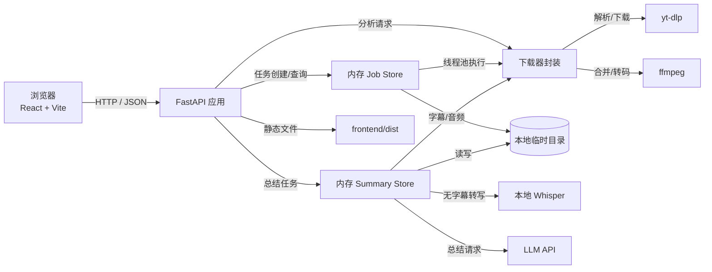
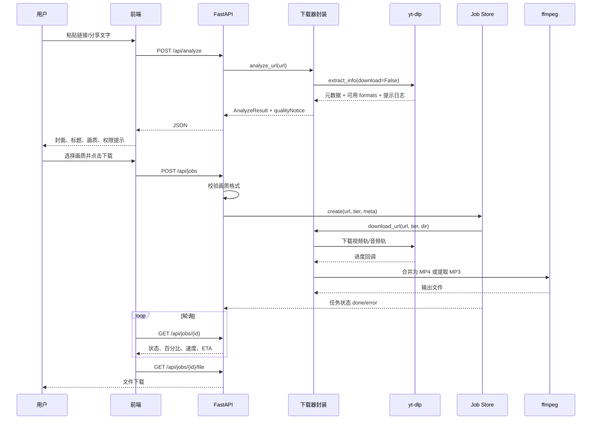
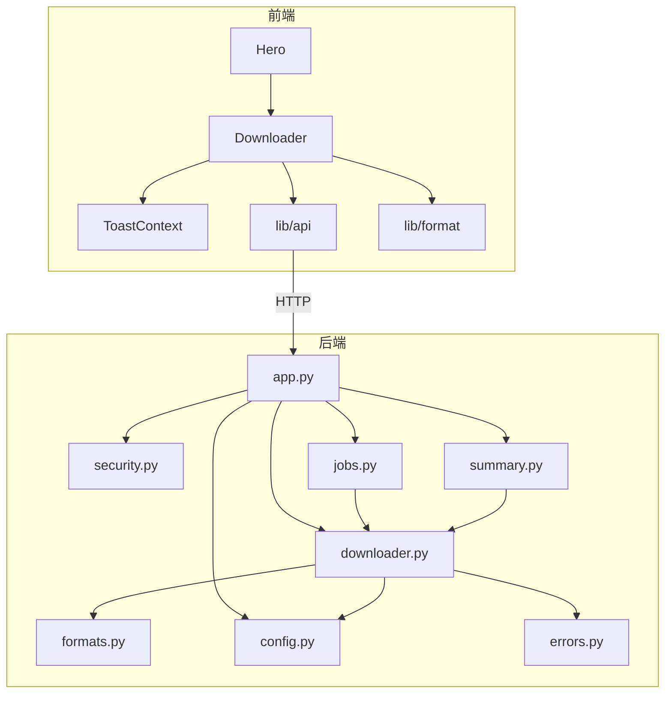

# 收片 ClipDock 方案设计说明书

| 项目 | 内容 |
| --- | --- |
| 文档版本 | v1.0 |
| 文档状态 | Phase 1 已实现 |
| 更新日期 | 2026-10-28 |
| 关联需求 | [需求规格说明书](REQUIREMENTS.md) |
| 详细产品方案 | [产品与技术方案](PROPOSAL.md) |

## 1. 技术路线

| 层次 | 选型 | 选型原因 |
| --- | --- | --- |
| 前端 | React 19 + Vite 8 + TypeScript | 组件化、构建快、适合桌面和移动端响应式页面 |
| 样式 | 原生 CSS 设计系统 | 精确控制纸感视觉、回执卡片、响应式和动效，不引入额外 UI 框架 |
| 后端 | Python 3.13 + FastAPI + Uvicorn | 与 yt-dlp 同为 Python 生态，可直接调用库接口，无需拼接命令行 |
| 解析与下载 | yt-dlp Python API | 复用成熟平台解析能力，避免自行维护平台协议 |
| 音视频处理 | imageio-ffmpeg 自带 ffmpeg | 视频轨与音频轨合并、MP3 提取，不依赖系统安装 ffmpeg |
| AI 转写 | faster-whisper | 无字幕时本地转写，音频不离开服务器 |
| AI 总结 | OpenAI 兼容接口 | 支持 DeepSeek / OpenAI / 通义等模型 |
| 任务状态 | 内存 Job Store / Summary Store + ThreadPoolExecutor | 下载任务保持轻量；笔记状态落 Markdown + SQLite 索引 |
| 文件存储 | 本地临时目录 + `data/library/` | 下载文件短期中转；笔记 Markdown 长期保存 |
| 仓库索引 | SQLite（标准库，单文件） | 列表/搜索/批量操作；删库可扫描 Markdown 重建 |
| 部署 | FastAPI 单进程托管前端静态文件 | 一个端口启动，降低演示和自部署成本 |

前端不直接调用平台接口，也不接触 cookies；所有解析和文件操作都在服务端完成。

## 2. 总体架构



### 分层职责

| 层次 | 职责 |
| --- | --- |
| 展示层 | 输入、解析结果、画质选择、进度、暂停/取消、AI 总结、FAQ 与响应式布局 |
| 接口层 | 参数校验、错误转换、静态文件托管 |
| 业务层 | 解析视频、构建画质档位、创建任务、维护进度、暂停/取消、清理文件 |
| 总结层 | 字幕提取、音频转写、大模型总结 |
| 适配层 | 封装 yt-dlp、ffmpeg、Whisper、OpenAI 兼容接口、cookies、代理和平台错误 |
| 运行环境 | 临时目录、线程池、环境变量、磁盘余量检查 |

## 3. 系统运行流程



### 关键状态

```text
queued → downloading ──暂停──→ pausing → paused ──继续──→ downloading
   │          │                                          
   │          └──取消──→ cancelling → cancelled
   └──取消──→ cancelling → cancelled

downloading → processing → done
                   │
                   └──取消──→ cancelling → cancelled
                   └──失败──→ error
```

- `queued`：任务已创建，等待线程池执行。
- `downloading`：正在下载视频轨或音频轨。
- `pausing` / `paused`：暂停信号已发出 / 已保留分片等待继续。
- `processing`：正在合并音视频或转码，暂停不可用，取消延迟生效。
- `cancelling` / `cancelled`：正在清理 / 已清理临时文件。
- `done` / `error`：完成或失败。
- `error`：解析、下载、合并或磁盘检查失败。

## 4. 模块设计

### 4.1 后端模块

| 模块 | 职责 | 依赖 | 输入 | 输出 |
| --- | --- | --- | --- | --- |
| `backend/app.py` | API 路由、异常处理、静态文件托管 | 下载器、Job Store、Summary Store、安全模块 | HTTP 请求 | JSON、文件响应、前端页面 |
| `backend/downloader.py` | yt-dlp 封装、格式提示解析、ffmpeg 合并、错误映射 | yt-dlp、imageio-ffmpeg、配置 | 视频 URL、画质档位、临时目录 | 元数据、输出文件、进度事件 |
| `backend/formats.py` | 从 formats 构建 720P/1080P/最高画质/音频档位，生成 selector | 无 | yt-dlp info | 画质档位、最高高度 |
| `backend/jobs.py` | 内存任务表、线程池、进度、暂停/取消、文件路径、TTL 清理 | 下载器、配置 | 任务创建请求 | 任务状态、文件句柄 |
| `backend/summary.py` | 字幕提取、音频转写、并行调度、取消/重试、任务快照、LLM 总结 | 下载器、faster-whisper、httpx、配置 | 视频 URL、元数据 | 完整结构化总结、进度、错误、任务状态 |
| `backend/security.py` | URL 规范化、SSRF 防护 | 配置 | URL | 安全 URL |
| `backend/config.py` | 环境变量、临时目录、大小/时长限制 | 无 | 环境变量 | 运行配置 |
| `backend/errors.py` | 稳定的用户错误码与消息 | 无 | 业务异常 | API 错误响应 |

### 4.2 前端模块

| 模块 | 职责 |
| --- | --- |
| `components/Hero.tsx` | 首屏文案、下载入口、装饰性收片回执 |
| `components/Downloader.tsx` | 剪贴板提取、解析状态、结果卡片、画质选择、下载轮询、暂停/取消 |
| `components/SummaryPanel.tsx` | AI 总结入口，接入全局任务上下文 |
| `components/SummaryTaskView.tsx` | 总结进度、结构化结果、完整文案共用视图 |
| `components/TaskCard.tsx` | 任务中心卡片、取消/重试入口 |
| `components/BatchSummary.tsx` | 批量链接输入与入队 |
| `pages/TaskCenterPage.tsx` | 并行任务中心 |
| `pages/TaskDetailPage.tsx` | 单个任务详情 |
| `context/SummaryQueueContext.tsx` | 全局任务注册表、轮询、localStorage、通知 |
| `context/ToastContext.tsx` | 复制、成功、失败等轻提示 |
| `lib/api.ts` | API 客户端、错误解析、任务请求 |
| `lib/summary.ts` | 阶段/状态文案、任务活跃判断、总结 Markdown |
| `lib/format.ts` | 链接提取、URL 校验、高度/大小/时长格式化 |
| `lib/types.ts` | 前后端共享的前端类型 |
| `index.css` | 设计令牌、组件样式、响应式和动效 |

### 4.3 模块关系



## 5. 接口设计

### 5.1 外部 API

| 接口组 | 提供方 | 使用方 | 用途 | 主要输入 | 主要输出 |
| --- | --- | --- | --- | --- | --- |
| `POST /api/analyze` | 后端 | 前端 | 解析视频元数据与画质 | 视频 URL | 标题、封面、时长、平台、画质、权限提示 |
| `POST /api/jobs` | 后端 | 前端 | 创建下载任务 | URL、画质、元数据 | 任务对象 |
| `GET /api/jobs/{id}` | 后端 | 前端 | 查询下载进度 | 任务编号 | 状态、百分比、速度、ETA、文件名、可执行操作 |
| `POST /api/jobs/{id}/pause` | 后端 | 前端 | 暂停下载 | 任务编号 | 暂停中/已暂停状态 |
| `POST /api/jobs/{id}/resume` | 后端 | 前端 | 从分片继续下载 | 任务编号 | 恢复后的任务状态 |
| `POST /api/jobs/{id}/cancel` | 后端 | 前端 | 取消并清理临时文件 | 任务编号 | 取消中/已取消状态 |
| `GET /api/jobs/{id}/file` | 后端 | 浏览器 | 下载完成文件 | 任务编号 | 文件流 |
| `GET /api/summaries` | 后端 | 前端 | 任务列表/轮询 | `ids`、`status`、`limit` | 轻量任务列表、活跃/排队数 |
| `POST /api/summaries` | 后端 | 前端 | 创建 AI 总结任务 | URL、元数据 | 总结任务（可命中缓存/去重） |
| `GET /api/summaries/{id}` | 后端 | 前端 | 查询总结进度与结果 | 总结编号 | 阶段、进度、结构化结果、文案状态 |
| `POST /api/summaries/{id}/cancel` | 后端 | 前端 | 取消任务或文案整理 | 总结编号 | 取消中/已取消状态 |
| `POST /api/summaries/{id}/retry` | 后端 | 前端 | 重试失败/取消任务 | 总结编号 | 重新排队状态 |
| `GET /api/summaries/{id}/transcript` | 后端 | 前端/调试 | 原始转写 | 总结编号 | 带时间戳的转写文本与来源 |
| `GET /api/summaries/{id}/article` | 后端 | 前端 | 查询 AI 完整文案 | 总结编号 | 状态、进度、Markdown 文案 |
| `POST /api/summaries/{id}/article` | 后端 | 前端 | 生成/重试完整文案 | 总结编号 | 文案任务状态 |
| `GET /api/library` | 后端 | 前端 | 仓库列表/搜索/分页 | 查询条件 | 笔记元数据、AI 摘要、状态 |
| `GET /api/library/{id}/content` | 后端 | 前端 | 读取 Markdown | 笔记编号 | 完整 Markdown |
| `GET /api/library/{id}/download` | 后端 | 浏览器 | 下载单篇笔记 | 笔记编号 | `.md` 文件流 |
| `POST /api/library/batch-download` | 后端 | 前端 | 多选打包 zip | 笔记编号列表 | zip（含 index.md） |
| `POST /api/library/batch-delete` | 后端 | 前端 | 多选移入回收站 | 笔记编号列表 | 删除结果 |
| `POST /api/library/batch-restore` | 后端 | 前端 | 从回收站恢复 | 笔记编号列表 | 恢复结果 |
| `GET /api/health` | 后端 | 运维/前端 | 健康检查 | 无 | 版本、ffmpeg、磁盘、任务数、cookies / 总结 / 文案 / Whisper 状态 |

### 5.2 内部分析接口

| 接口组 | 提供方 | 使用方 | 用途 |
| --- | --- | --- | --- |
| `analyze_url()` | 下载器 | API | 解析 URL，生成用户展示数据 |
| `download_url()` | 下载器 | Job Store | 下载、合并并回调进度 |
| `build_formats()` | 格式模块 | 下载器 | 把原始 formats 转换为少量画质档位 |
| `selector_for()` | 格式模块 | 下载器 | 把档位映射为稳定的 yt-dlp format selector |
| `JobStore.create()` / `pause()` / `resume()` / `cancel()` | Job Store | API | 创建、暂停、继续、取消下载任务 |
| `SummaryStore.create()` / `get()` | Summary Store | API | 创建总结任务、返回完整结果 |
| `normalize_url()` | 安全模块 | API | 规范化并验证公网 URL |

## 6. 数据结构设计

| 数据名称 | 归属 | 用途 | 关键内容 |
| --- | --- | --- | --- |
| `AnalyzeResult` | 分析接口 | 前端展示解析结果 | 标题、封面、时长、平台、当前最高高度、格式列表、权限提示 |
| `FormatOption` | 分析接口 | 画质选项 | 档位 ID、显示名称、高度、大小、视频/音频 |
| `QualityNotice` | 分析接口 | 解释缺失的更高画质 | 错误码、用户文案、缺失档位、当前最高高度 |
| `Job` | Job Store | 下载任务状态 | 任务 ID、状态、进度、速度、ETA、文件名、错误、下载地址、暂停/取消能力 |
| `SummaryJob` | Summary Store | AI 总结/文案任务状态 | 总结 ID、阶段、进度、转写来源、结构化结果、转写字符数、文案状态/进度/错误 |
| `SummaryResult` | Summary Store | 前端展示总结 | 一句话总结、要点、章节、引用、关键词、模型信息 |
| `Article` | Summary Store | AI 完整文案 | Markdown 正文、状态（idle/processing/done/error）、字符数 |
| `Note` | Library Store | Markdown 仓库索引 | ID、标题、文件路径、AI 摘要、出处、平台、UP 主、状态、大小、回收站路径 |

### 6.1 画质档位规则

- 720P 档位：优先选择不超过 720P 的最高视频；如果源站最高不足 720P，则展示实际最高档位。
- 1080P 档位：源站最高高度达到 1080P 时展示，可直接下载。
- 最高画质档位：源站最高高度超过 1080P 时展示，显示实际高度对应的 2K/4K 标签。
- 音频档位：始终可用，输出 MP3。
- 画质档位只来自解析器实际拿到的 formats；没有 4K 格式时不生成 4K 档位。

### 6.2 4K 权限提示

`downloader.py` 捕获 yt-dlp 的 debug 信息，例如：

```text
Format(s) HDR 真彩, 4K 超高清, 1080P 60帧 are missing;
you have to become a premium member...
```

仅当缺失档位包含 4K/8K/2K/HDR/杜比等更高画质时，才生成 `qualityNotice`。普通 1080P 高码率缺失不提示，避免干扰。

## 7. 关键设计决策

### 7.1 使用 yt-dlp Python API

后端直接调用 Python 库，不拼接 shell 命令。这样可以：

- 避免 URL 注入和命令行转义问题；
- 直接使用 `extract_info`、progress hooks 和 logger；
- 更方便捕获平台缺失画质的提示；
- 复用 yt-dlp 的 extractor、cookie、代理和更新能力。

### 7.2 不引入数据库

首期使用内存任务表和临时目录：

- 部署简单，只需 Python 和 Node 构建；
- 不需要用户体系；
- 适合演示和单机自部署。

代价是服务重启会丢失任务和历史记录。需要持久化时再引入数据库和任务队列。

### 7.3 固定画质档位，不暴露原始 format id

前端只看到 720P、1080P、最高画质、音频四个稳定档位。后端把档位映射为 selector，避免客户端传入任意 format id 或格式字符串。

### 7.4 私人免费版

- 不提供登录、邀请码、价格页、支付或订阅。
- 720P、1080P、最高可用画质和音频都直接创建任务。
- 服务端不校验 Pro token，`/api/pro/*` 接口已移除。
- 前端不加载 Pro 弹窗和 Pro 上下文。

### 7.5 剪贴板与链接提取

浏览器剪贴板经常包含中文标题、表情和分享文案。前端 `extractVideoUrl()` 从任意文本中提取：

- 完整 `https://...` 链接；
- `b23.tv/...` 等裸域名链接；
- 去掉中文标点和尾部文案；
- 优先匹配已知视频平台域名。

HTTP 局域网地址下浏览器禁用 `navigator.clipboard`，此时页面引导用户长按输入框手动粘贴；手动粘贴事件同样会提取链接。

### 7.6 安全设计

- 只接受公网 HTTP/HTTPS URL。
- 拒绝 localhost、私网 IP、link-local、保留地址和 `file://`、`javascript:` 等协议。
- 文件下载接口只接受任务 ID，不接受客户端文件路径。
- cookies 只由服务端文件提供，不存入浏览器或数据库。
- 临时文件随机目录，30 分钟后清理。
- 私人使用；如暴露到公网，请自行增加访问控制。

### 7.7 4K 与文件大小

- 默认单文件上限 4GB，可通过 `MAX_FILESIZE_BYTES` 调整。
- 创建任务前检查磁盘余量，至少保留 `MIN_FREE_BYTES + MAX_FILESIZE_BYTES`。
- 4K 需要源站返回 4K formats；服务端没有登录权限时不会伪造 4K。
- 4K 通常需要服务端配置有权限的 cookies，配置方式见 README。

### 7.8 下载暂停与取消

- 每个任务维护 `pause_requested` 和 `cancel_requested` 两个信号。
- `download_url()` 在 yt-dlp 进度回调中调用 `checkpoint()`；信号命中时抛出 `DownloadPaused` / `DownloadCancelled`。
- 暂停保留 `.part` 文件，继续时用相同 `outtmpl` 重新提交任务，yt-dlp 默认 `continuedl=True` 从分片继续。
- 取消会删除任务目录并标记 `cancelled`。
- 音视频合并阶段不响应暂停，避免中断 ffmpeg 产生残留；取消会标记 `cancelling`，在合并返回后清理。
- 任务状态：`queued` / `downloading` / `pausing` / `paused` / `processing` / `cancelling` / `cancelled` / `done` / `error`。

### 7.9 AI 总结与完整文案

- 独立 `SummaryStore` 管理总结任务，不与下载任务共享目录。
- 先调用 `fetch_subtitle_text()` 提取平台字幕；没有字幕时只下载 bestaudio（不再先转 MP3），用 ffmpeg 解码后交给本地 `faster-whisper`。
- 转写文本交给 OpenAI 兼容接口，要求返回结构化 JSON：`tldr`、`keyPoints`、`chapters`、`quotes`、`keywords`、`suitableFor`。
- 长文本按片段压缩后再汇总，限制送入模型的字符数。
- 总结完成后，后台继续把同一份转写整理成 Markdown 文章：分节、补标点、去口头禅、保留事实与术语；长转写分段整理。
- 总结与文案解耦：总结先返回，文案在后台生成；文案失败不影响总结查看。
- 转写、总结、文案按 URL + 模型 + prompt 版本缓存到 `data/cache/summary-cache/`，同一视频二次打开直接命中。
- 模型默认 `deepseek-flash`；模型未配置时返回 503，不影响下载。
- 总结结束或失败后删除临时音频/字幕目录，结果与缓存保留；文案生成使用转写文本，不依赖临时目录。

## 8. 错误处理

| 场景 | 用户提示 | 处理 |
| --- | --- | --- |
| 需要登录/会员 | 该清晰度需要登录或会员权限 | 返回 `qualityNotice` 或 `AUTH_REQUIRED` |
| 不支持的链接 | 这个链接暂不支持 | `UNSUPPORTED` |
| 私密/付费内容 | 无法访问 | `PRIVATE_VIDEO` |
| DRM | 无法下载 | `DRM_PROTECTED` |
| 直播/预告 | 暂不支持 | `LIVE_UNSUPPORTED` |
| 超时长/超大文件 | 超出限制 | `TOO_LONG` / `TOO_LARGE` |
| 解析超时 | 稍后重试 | `TIMEOUT` |
| 磁盘不足 | 临时空间不足 | `DISK_FULL` |
| 合并中暂停 | 暂时不能暂停 | `CANNOT_PAUSE` |
| 已结束任务取消 | 任务已经结束 | `JOB_NOT_ACTIVE` |
| 总结未配置 | AI 总结暂不可用 | `SUMMARY_NOT_CONFIGURED` |
| 无字幕/无语音 | 没有可总结的内容 | `NO_SPEECH` |
| 总结模型失败 | 稍后重试 | `SUMMARY_API_ERROR` |
| 总结 JSON 格式异常 | 自动修复；仍失败降级为简要总结 | 仅在无法降级时返回 `SUMMARY_FORMAT_ERROR` |
| 未知错误 | 稍后重试或换链接 | `DOWNLOAD_FAILED` / `ANALYZE_FAILED` |

后端日志记录未映射的 yt-dlp 错误，前端展示用户可理解的中文文案。

## 9. 运维与部署

### 9.1 启动

```powershell
.\start.ps1
```

或：

```powershell
.\.venv\Scripts\python.exe -m uvicorn backend.app:app --host 0.0.0.0 --port 8000
```

前端构建：

```powershell
cd frontend
npm run build
```

FastAPI 在启动时托管 `frontend/dist`，API 和页面使用同一个端口。

### 9.2 配置

| 变量 | 作用 |
| --- | --- |
| `YTDLP_COOKIES` | 服务端 cookies 文件路径 |
| `YTDLP_PROXY` | 下载代理 |
| `SUMMARY_API_BASE` | OpenAI 兼容接口地址 |
| `SUMMARY_API_KEY` | 总结模型密钥；为空时关闭总结 |
| `SUMMARY_MODEL` | 总结/整理稿模型名称，默认 `deepseek-flash` |
| `SUMMARY_WORKERS` | 同时推进的总结任务数，默认 3 |
| `SUMMARY_TRANSCRIBE_WORKERS` | Whisper 并发路数，默认 1 |
| `SUMMARY_LLM_CONCURRENCY` | LLM 请求总并发，默认 4 |
| `SUMMARY_ARTICLE_WORKERS` | 文案并行数，默认 2 |
| `SUMMARY_QUEUE_MAX` | 活跃任务上限，默认 20 |
| `SUMMARY_JOB_TTL_SECONDS` | 任务中心历史保留时间，默认 24 小时 |
| `SUMMARY_LLM_RETRIES` | 429/5xx/超时重试次数，默认 2 |
| `SUMMARY_PERSIST_JOBS` | 是否写任务快照，默认 true |
| `SUMMARY_MAX_DURATION_SECONDS` | 总结视频最大时长 |
| `SUMMARY_MAX_CHARS` | 送入总结模型的转写文本上限 |
| `SUMMARY_ARTICLE_ENABLED` | 是否生成 AI 完整文案 |
| `SUMMARY_ARTICLE_MAX_CHARS` | 整理稿最多处理的转写字符数 |
| `SUMMARY_CACHE_TTL_SECONDS` | 转写/总结/文案缓存保留时间 |
| `CLIPDOCK_CACHE_DIR` | 下载临时文件与 AI 缓存目录 |
| `WHISPER_MODEL` / `WHISPER_DEVICE` / `WHISPER_COMPUTE_TYPE` | 本地 Whisper 配置 |
| `MAX_DURATION_SECONDS` | 单视频最大时长 |
| `MAX_FILESIZE_BYTES` | 单文件最大大小 |
| `MIN_FREE_BYTES` | 最低磁盘余量 |
| `JOB_TTL_SECONDS` | 临时文件保留时间 |
| `DOWNLOAD_WORKERS` | 并发下载数 |

### 9.3 当前日志现状

当前 uvicorn、应用 logger 和 yt-dlp 错误输出到启动进程的 stdout/stderr，尚未写入独立日志文件。排查时需要在启动终端查看；后续可增加 `logs/clipdock.log` 和轮转。

### 9.4 临时文件

- 任务文件位于 `data/cache/jobs/<job_id>`（可用 `CLIPDOCK_CACHE_DIR` 覆盖）。
- 成功或失败任务在 TTL 后删除。
- 清理线程定期删除过期任务和孤儿目录。
- AI 转写/总结/文案缓存在 `data/cache/summary-cache/`，默认保留 30 天。

## 10. 测试与验收

| 测试层 | 内容 |
| --- | --- |
| 单元测试 | 画质档位、4K 提示解析、URL 校验、字幕解析、总结 JSON、完整文案、缓存 |
| API 测试 | 分析接口、1080P 直接创建任务、暂停/继续/取消、总结未配置、转写/文案接口、健康检查 |
| 真实链路 | B 站 720P/1080P 下载、ffmpeg 合并、暂停续传、取消清理、文件分辨率校验 |
| 前端构建 | `npm run build` 类型检查与 Vite 构建 |
| E2E | Playwright 验证桌面/手机布局、结果卡、剪贴板提取、4K 提示、暂停/取消、AI 总结完整结果 |
| 安全检查 | localhost、内网 IP、危险协议 |

当前验证结果：

- 后端 57 个 pytest 用例通过（含转写缓存、完整文案、缓存命中、并行任务、取消/重试、去重、持久化和限流重试）。
- B 站 720P 文件：1280×720 H.264 + AAC。
- B 站 1080P 文件：1920×1080 H.264 + AAC。
- 4K 样本未配置 cookies 时最高 1080P，页面显示权限提示。
- 暂停后保留 `.part` 分片，继续后完成下载并删除临时目录。
- 本地 Whisper 用测试音频转写通过；总结后端用 mock LLM 跑通完整链路。
- 1440 / 1024 / 768 / 390 宽度无横向滚动。

## 11. 扩展点

| 扩展 | 设计位置 |
| --- | --- |
| 批量下载 | Job Store 增加批次对象和并发队列；前端增加多链接输入 |
| 字幕下载 / 字幕翻译 | 在总结模块的字幕提取基础上增加文件打包和翻译 |
| 多模态总结 | 在现有转写文本之外增加关键帧/视觉模型 |
| 访问控制 | 私人版如部署到公网，可增加密码或反向代理认证 |
| 历史记录 | 新增用户与任务持久化；需要登录体系 |
| 持久化日志 | 增加 RotatingFileHandler 和日志查询接口 |
| 多用户 cookies | 需要凭据加密、隔离和平台条款评估，当前不实现 |

## 12. 已知风险

1. 平台接口和风控持续变化，yt-dlp 需要定期升级。
2. 4K/HDR 经常需要登录或会员权限，服务端 cookies 可能过期。
3. 4K 文件较大，服务器带宽、磁盘和下载耗时都明显增加。
4. 公开部署存在版权、平台条款和合规风险。
5. 下载任务在内存中，重启会丢失进行中的任务；笔记仓库持久化在 `data/library/`，SQLite 只是可重建索引；当前日志未落盘，排障依赖运行终端。
6. 部分平台需要代理、Cookies 或额外依赖（如 TikTok impersonation）。
7. 本地 Whisper 首次使用需要下载模型，CPU 转写长视频耗时明显。
8. 总结模型需要 OpenAI 兼容密钥；每次总结都会产生模型调用，请自行控制使用量。
9. 合并阶段暂停不可用，取消只能在合并结束后完成清理。

## 13. 并行任务与任务中心（Phase 1.4）

### 13.1 并发模型

| 资源 | 默认 | 实现 |
| --- | --- | --- |
| 总结任务 | 3 | `ThreadPoolExecutor(max_workers=SUMMARY_WORKERS)` |
| Whisper 转写 | 1 | 进程级 `BoundedSemaphore(SUMMARY_TRANSCRIBE_WORKERS)`，等待时可取消 |
| LLM 请求 | 4 | 进程级 `BoundedSemaphore(SUMMARY_LLM_CONCURRENCY)` |
| 完整文案 | 2 | `ThreadPoolExecutor(max_workers=SUMMARY_ARTICLE_WORKERS)` |
| 活跃任务 | 20 | 超过 `SUMMARY_QUEUE_MAX` 返回 `SUMMARY_TOO_BUSY` |

LLM 调用对 429、500/502/503/504、超时和连接错误做指数退避 + 抖动重试，优先读取 `Retry-After`。Whisper 解码放在信号量内，避免并行解码放大内存。

### 13.2 任务状态与接口

总结任务状态：`queued / processing / cancelling / cancelled / done / error`。
阶段：`queued / fetching_subtitles / downloading_audio / waiting_transcription / transcribing / summarizing / done / error / cancelling / cancelled`。
文案状态独立：`idle / processing / done / error / cancelled`。

新增接口：

- `GET /api/summaries?ids=&status=&limit=`：轻量列表，不返回完整 `result`。
- `POST /api/summaries/{id}/cancel`：协作式取消；已完成但文案仍在生成时只取消文案。
- `POST /api/summaries/{id}/retry`：原地重置失败/取消的任务，复用转写缓存。

`SummaryJob.public()` 增加 `url / uploader / queuePosition / transcribeQueuePosition / canCancel / canRetry / deduped / retryCount / startedAt / finishedAt / hasResult / tldr`。

### 13.3 去重、缓存与持久化

- `_active_by_url` 保证同一 URL 只有一个活跃任务；重复创建返回已有任务并标记 `deduped=true`。
- 命中总结缓存时直接返回 `done`，不占队列；命中转写缓存时跳过下载/转写。
- 任务元数据写入 `data/cache/summary-jobs.json`；只在创建、终态、取消、重试、关闭时写入，不按进度写盘。
- 启动时读取快照：运行中任务标记 `SUMMARY_INTERRUPTED` 并同步笔记错误；已完成任务从 `summary-cache` 恢复结果。
- 清理线程每 60 秒删除超过 TTL 的终态任务和孤儿临时目录。

### 13.4 前端结构

- `SummaryQueueProvider` 全局持有任务，统一轮询 `GET /api/summaries?ids=...`，并把 ID 和展示信息写入 localStorage。
- `SummaryPanel` 不再自己轮询；关闭面板只隐藏，任务继续。
- `#/tasks` 任务中心：批量粘贴、统计、筛选、任务卡片、取消/重试/清理。
- `#/tasks/{id}` 任务详情：进度、总结、完整文案、笔记链接、取消/重试。
- 完成时 Toast + 标题角标；可选桌面通知（localhost/HTTPS）。
- 批量先并行解析（最多 3 条），解析完一条入队一条；完整 URL 和裸域名归一化后去重。

### 13.5 已知取舍

- 批量解析阶段需要页面保持打开；入队后可以关闭。
- 总结线程在等待 Whisper 信号量时会占一个任务槽；默认 3 路仍可让字幕类任务并行，后续可拆阶段队列。
- 取消无法中断已发出的 LLM HTTP 请求，最长等待一个请求超时。
- 任务快照不存完整 result；缓存过期时任务卡片保留笔记链接。
