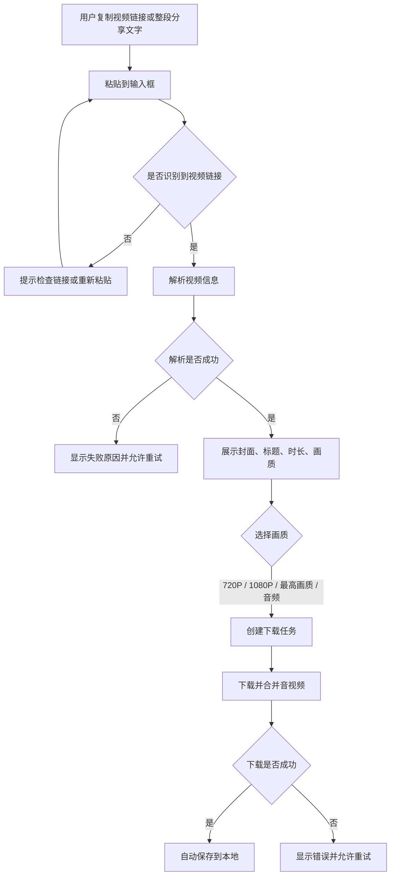

# 收片 ClipDock 需求规格说明书

| 项目 | 内容 |
| --- | --- |
| 文档版本 | v1.0 |
| 文档状态 | Phase 1 已实现，等待验收 |
| 更新日期 | 2026-10-28 |
| 关联方案 | [方案设计说明书](DESIGN.md)、[产品与技术方案](PROPOSAL.md) |
| 产品名称 | 收片 CLIPDOCK |

## 1. 产品概述

### 1.1 原始需求摘要

用户希望开发一个「万能视频下载网站」，解决以下问题：

- 有些平台的视频不提供下载功能，或者下载入口不方便。
- 部分平台不支持批量下载，或者有清晰度、登录、客户端等限制。
- 希望下载更快，电脑和手机都能使用。
- 希望前台界面有辨识度，参考 `https://ai.codefather.cn/painting` 的视觉风格，突出工具感而不是营销感。
- 后端尽量轻量，首期不引入数据库。
- 视频解析和下载复用成熟开源项目，不自行承担平台协议风险，指定使用 yt-dlp。
- 需要先给出方案并人工确认，再分步骤开发、测试和验收。
- 私人使用，不公开收费，不做付费墙。

### 1.2 已确认的产品决策

| 决策项 | 确认结果 |
| --- | --- |
| 品牌名 | 收片 CLIPDOCK |
| 视觉方向 | 暖纸白、电光蓝、荧光绿、收片回执风格 |
| 首期范围 | 单链接下载，720P/1080P/最高画质全部开放，含 AI 总结 |
| 付费方式 | 无付费、无邀请码、无价格页 |
| 首期技术取舍 | 下载任务无数据库、无登录、内存任务、临时文件；笔记仓库 SQLite 索引 |
| 前台技术露出 | 不展示 yt-dlp、GitHub、开源引擎等第三方技术信息 |

### 1.3 产品目标

为目标用户提供一个低门槛的视频保存入口：粘贴视频链接或整段分享文字，解析视频信息，选择画质，完成下载。用户不需要安装软件，不需要注册账号，手机浏览器也能完成操作。

### 1.4 目标用户

- 需要保存素材的内容创作者、运营和学生。
- 希望把公开视频保存到本地的普通用户。
- 主要在手机端使用、希望操作步骤尽量少的用户。

## 2. 范围与边界

### 2.1 本期范围

- 单条视频链接解析。
- 中文分享文字中的链接提取。
- 720P / 1080P / 最高可用画质下载。
- 真实下载进度、音视频合并、自动保存。
- 下载中暂停、继续和取消。
- AI 视频总结：字幕优先，无字幕时本地 Whisper 转写，返回完整结果。
- 桌面与手机响应式页面。
- 临时文件中转与自动清理。
- 平台限制、版权和失败原因提示。

### 2.2 后续规划

- 批量链接解析与批量下载。
- 字幕下载、字幕翻译。
- PWA / 添加到主屏幕。
- 持久化历史记录（需要数据库）。
- 公网访问密码 / 反向代理认证。

### 2.3 不包含

- 破解 DRM、付费内容、私密内容或会员权限。
- 用超分辨率把 1080P 伪装成 4K。
- 网页端上传账号 cookies、账号池或多账号轮换。
- 视频托管、推荐流、社区和内容分发。
- 任何付费墙、订阅、订单和真实支付流程。

## 3. 用户业务流程

## 4. 功能模块与功能点

```mermaid
flowchart TD
    R[收片 ClipDock] --> M1[链接输入与识别]
    R --> M2[视频解析与信息展示]
    R --> M3[画质选择]
    R --> M4[下载与进度]
    R --> M5[移动端与隐私]
    R --> M6[帮助与合规提示]

    M1 --> F11[粘贴链接]
    M1 --> F12[从分享文字提取链接]
    M1 --> F13[链接校验]

    M2 --> F21[解析视频信息]
    M2 --> F22[展示视频元数据]
    M2 --> F23[说明缺失的高画质]

    M3 --> F31[选择 720P]
    M3 --> F32[选择 1080P]
    M3 --> F33[选择最高可用画质]

    M4 --> F41[创建下载任务]
    M4 --> F42[查看下载进度]
    M4 --> F43[自动保存与重试]
    M4 --> F44[错误提示]
    M4 --> F45[暂停下载]
    M4 --> F46[继续下载]
    M4 --> F47[取消下载]

    M5 --> F51[手机端适配]
    M5 --> F52[临时文件清理]

    M6 --> F61[平台限制说明]
    M6 --> F62[版权与合规提示]

    R --> M7[AI 视频总结]
    M7 --> F71[生成视频总结]
    M7 --> F72[返回完整总结]
    M7 --> F73[字幕优先与语音转写回退]

    R --> M8[并行任务中心]
    M8 --> F81[批量入队]
    M8 --> F82[任务进度与队列]
    M8 --> F83[取消与重试]
    M8 --> F84[刷新与重启恢复]
```

### 4.1 链接输入与识别

| 功能名称 | 功能描述 | 输入 | 输出 |
| --- | --- | --- | --- |
| 粘贴链接 | 用户点击「粘贴」读取剪贴板，系统提取视频链接并填入输入框。 | 用户点击粘贴按钮 | 输入框中的视频链接；无法读取时显示手动粘贴提示 |
| 从分享文字提取链接 | 用户粘贴中文标题、表情、链接和「复制此链接」等混合文本时，系统只保留可用链接。 | 整段分享文字 | 清洗后的视频链接 |
| 链接校验 | 系统检查链接是否为空、是否包含有效域名、是否为本机或内网地址。 | 用户输入或粘贴的内容 | 可解析链接，或明确的错误提示 |

**验收表现**

- 剪贴板内容为 `【标题】https://... 复制此链接` 时，输入框只保留 `https://...`。
- 手动粘贴整段分享文字后直接点「开始收片」也能解析。
- 局域网 HTTP 环境下浏览器禁止一键读取剪贴板时，页面提示用户长按输入框手动粘贴。

### 4.2 视频解析与信息展示

| 功能名称 | 功能描述 | 输入 | 输出 |
| --- | --- | --- | --- |
| 解析视频信息 | 系统读取视频标题、作者、时长、封面、平台和当前可用画质。 | 有效视频链接 | 解析结果卡片 |
| 展示视频元数据 | 在结果卡片中展示封面、标题、作者、时长、平台和当前最高可下载画质。 | 解析结果 | 用户可核对的信息 |
| 说明缺失的高画质 | 源站还有 4K、HDR、2K 或高帧率，但当前账号无权限时，页面说明缺失档位和当前最高画质。 | 平台返回的权限提示 | 画质提示条 |

**验收表现**

- B 站 4K 视频未配置登录信息时，页面显示最高 1080P，并提示 4K/HDR 需要登录或会员权限。
- 普通 1080P 视频不显示无关的 4K 提示。
- 解析失败时显示可操作的中文原因，并保留错误码用于排障。

### 4.3 画质选择

| 功能名称 | 功能描述 | 输入 | 输出 |
| --- | --- | --- | --- |
| 选择 720P | 用户选择 720P 档位并直接下载。 | 用户选择 720P | 下载任务 |
| 选择 1080P | 源站提供 1080P 时，用户可以直接选择并下载。 | 用户选择 1080P | 下载任务 |
| 选择最高画质 | 源站提供 2K/4K 时，用户可以选择最高可用档位。 | 用户选择最高画质 | 下载任务 |
| 选择音频 | 用户只保存 MP3 音频。 | 用户选择仅音频 | 音频任务 |
| 画质可用性判断 | 系统只展示源站实际返回的画质档位，不伪造 4K。 | 解析结果中的视频格式 | 可用画质档位 |

**验收表现**

- 720P、1080P 和最高可用画质都可以直接下载，没有付费拦截。
- 源站只返回 1080P 时，页面不显示 4K 档位，并说明原因。

### 4.4 下载与进度

| 功能名称 | 功能描述 | 输入 | 输出 |
| --- | --- | --- | --- |
| 创建下载任务 | 系统根据链接和画质创建后台下载任务。 | 链接、画质 | 任务编号和初始状态 |
| 查看下载进度 | 页面轮询任务状态，展示百分比、速度、剩余时间和处理阶段。 | 任务编号 | 实时进度面板 |
| 自动保存 | 下载和合并完成后，浏览器自动触发文件保存。 | 完成的任务 | 本地视频文件 |
| 手动再次保存 | 自动保存被浏览器拦截时，用户可以点击「再保存一次」。 | 已完成任务 | 文件下载链接 |
| 错误提示与重试 | 解析或下载失败时，页面展示原因和重试入口。 | 失败任务 | 错误说明、重试按钮 |
| 暂停下载 | 用户点击暂停，系统停止继续下载并保留临时分片。 | 进行中的任务 | 已暂停状态、继续与取消入口 |
| 继续下载 | 用户点击继续，系统从已有分片恢复下载。 | 已暂停任务 | 恢复后的进度 |
| 取消下载 | 用户确认取消，系统停止任务并清理临时文件。 | 进行中或已暂停任务 | 已取消状态、重新下载入口 |

**验收表现**

- 720P 下载完成后得到可播放的 MP4 文件。
- 1080P 下载完成后视频轨为 1920×1080。
- 下载过程中显示进度和合并状态。
- 文件超过大小限制时返回明确提示，不静默降级。
- 暂停后保留临时分片，继续后能完成下载。
- 取消后临时文件被清理，页面提供重新下载入口。
- 音视频合并阶段暂停按钮不可用，取消在当前合并完成后生效。

### 4.5 移动端与隐私

| 功能名称 | 功能描述 | 输入 | 输出 |
| --- | --- | --- | --- |
| 手机端适配 | 页面在 390px 宽度下可完成粘贴、解析、选画质和下载。 | 手机浏览器访问 | 无横向滚动的单列布局 |
| 临时文件清理 | 服务器只保留短期中转文件，过期自动删除。 | 下载任务文件 | 30 分钟后自动清理 |
| 不建视频库 | 系统不长期保存用户下载的视频，不要求注册账号。 | 用户访问 | 无需登录的使用流程 |

**验收表现**

- 390 / 768 / 1024 / 1440 宽度下无横向滚动。
- 手机端主要按钮触控高度达到 44px。
- 临时文件按配置时间清理。

### 4.6 帮助与合规提示

| 功能名称 | 功能描述 | 输入 | 输出 |
| --- | --- | --- | --- |
| 平台限制说明 | 页面说明登录、会员、DRM、地区限制和直播可能导致失败。 | 用户查看帮助 | 平台限制说明 |
| 版权提示 | 页面提示用户只下载拥有版权或已获授权的内容。 | 用户查看页脚或 FAQ | 合规提示 |
| 4K 权限说明 | 页面解释源站标注 4K 但当前只能下载 1080P 的原因。 | 用户查看结果或 FAQ | 4K 权限说明 |

### 4.7 AI 视频总结

| 功能名称 | 功能描述 | 输入 | 输出 |
| --- | --- | --- | --- |
| 生成总结 | 用户点击「AI 视频总结」，系统提取字幕或音频，生成结构化总结。 | 已解析的视频链接 | 完整的一句话总结、要点、章节、引用、关键词 |
| 字幕优先 | 平台有字幕时直接使用字幕，不下载视频或音频。 | 视频字幕 | 总结文本 |
| 语音转写回退 | 无字幕时只下载音频流，用本地 Whisper 转写后总结。 | 视频音频 | 带时间戳的转写文本 |
| 完整文案 | 总结完成后，把同一份转写整理成带标题、段落、列表的 Markdown 文章。 | 转写文本、总结章节 | AI 整理稿，可复制 / 下载 |
| 阅读模式 | 结果页左侧展示总结与完整文案，右侧 300px 媒体栏放置封面、画质和下载。 | 已解析视频 | 桌面双栏、移动端单列 |
| 缓存 | 同一视频的转写、总结、文案缓存，二次打开直接命中。 | 相同 URL | 秒出结果，不重复调用模型 |
| 总结失败提示 | 模型未配置、模型额度不足、无语音或接口失败时给出原因。 | 失败任务 | 可操作的中文提示 |

**验收表现**

- 有字幕的视频优先使用字幕，不下载完整视频。
- 无字幕的视频能走本地 Whisper 转写路径。
- 所有用户都能查看完整章节、时间戳、引用和关键词。
- 完整文案 tab 能显示带 Markdown 排版的文章，支持复制和下载 `.md`。
- 同一链接第二次打开时命中缓存，不再重复转写/调用模型。
- 模型未配置时接口返回明确提示，不生成伪造总结。
- 总结与文案均标注「AI 生成/整理，可能存在误差」。

### 4.8 笔记仓库

| 功能名称 | 功能描述 | 输入 | 输出 |
| --- | --- | --- | --- |
| 自动入库 | AI 总结开始时创建草稿，完成后自动生成 Markdown 笔记。 | 总结任务、元数据 | `data/library/*.md` |
| 文件内容 | 带 AI 摘要、出处、平台、UP 主、时长、完整文案和原始转写。 | 总结结果、转写 | 可独立阅读的 Markdown |
| 去重 | 同一视频按来源 URL 覆盖同一篇笔记。 | 重复总结 | 不产生重复文件 |
| 仓库列表 | 搜索、状态筛选、预览、按更新时间排序。 | 查询条件 | 笔记列表 |
| 批量下载 | 多选笔记打包为 zip。 | 笔记 ID 列表 | zip（含 index.md） |
| 批量删除 | 多选移到回收站，可恢复。 | 笔记 ID 列表 | 删除结果 |
| 索引重建 | SQLite 索引删除后扫描 Markdown 重建。 | Markdown 文件 | 索引记录 |

**验收表现**

- 总结完成后 `data/library/` 出现带 frontmatter、AI 摘要和出处的 `.md`。
- 同一 URL 重复总结不会出现两篇同名文件。
- 仓库能搜索、预览、多选下载 zip、多选删除到回收站。
- 删除 `data/library.sqlite3` 后重启，列表能从 Markdown 重建。

### 4.9 并行任务与任务中心

| 功能名称 | 功能描述 | 输入 | 输出 |
| --- | --- | --- | --- |
| 并行总结 | 多个视频的总结可以同时排队和执行；任务、Whisper、LLM、文案分别限流。 | 多个视频链接 | 多个后台任务 |
| 任务中心 | 独立 `#/tasks` 页面展示任务卡片、阶段、进度、队列位置、文案状态。 | 任务状态 | 可视化任务列表 |
| 批量入队 | 一次粘贴多条链接或整段分享文字，先并行解析标题，再逐条入队。 | 多行链接/分享文字 | 多个总结任务 |
| 任务与页面解耦 | 关闭总结面板、刷新页面、解析下一个视频，都不停止或丢失任务。 | 用户操作 | 任务继续，可回到任务中心 |
| 取消 | 排队/运行中的任务可以取消；总结完成后可取消文案整理。 | 任务编号 | 已取消状态、清理临时文件 |
| 重试 | 失败或已取消的任务可原地重试，复用转写缓存。 | 任务编号 | 重新排队 |
| 去重 | 同一 URL 的活跃任务只保留一个；命中缓存直接返回结果。 | 重复链接 | 不重复调用模型、不重复建笔记 |
| 持久化 | 页面刷新用 localStorage 恢复；服务重启用 JSON 快照恢复历史，运行中任务标记中断。 | 刷新/重启 | 任务恢复或可重试 |
| 完成提醒 | 后台任务完成时 Toast、标题角标；可选桌面通知。 | 任务完成 | 用户提示 |

**验收表现**

- 批量加入 3 条链接，3 条都出现在任务中心，不阻塞首页继续解析。
- 有字幕任务可并行总结；Whisper 并发不超过配置。
- 解析第 4 条视频后，前 3 条任务仍在任务中心更新。
- 刷新页面后任务恢复；服务重启后已完成任务可查，运行中任务显示已中断并可重试。
- 取消任务后临时文件清理，笔记标记已取消；重试不重复建笔记。
- 重复 URL 只产生一个活跃任务。
- 429/5xx 自动退避重试，最终失败有中文提示。
- 390px 宽度任务中心/详情无横向滚动。

## 5. 非功能要求

| 类别 | 要求 |
| --- | --- |
| 性能 | 常规链接解析通常在 3–15 秒内完成；下载进度应持续更新；无字幕视频的本地转写耗时取决于 CPU 和模型。 |
| 兼容性 | 支持现代桌面浏览器和移动浏览器；首期以 Chromium 内核为主要验证对象。 |
| 安全 | 只接受公网 HTTP/HTTPS 链接；拒绝 localhost、内网 IP 和危险协议；下载接口不接受客户端文件路径。 |
| 隐私 | 不建立用户账号和视频库；临时文件定期清理；cookies 只保存在服务端；音频在本地转写，仅字幕/转写文本发送给总结模型。 |
| 可用性 | 解析或下载失败时给出可理解的中文提示；重要按钮提供键盘焦点和触控尺寸；合并阶段明确不能暂停。 |
| 可维护性 | 平台解析能力复用成熟开源组件；前后端职责分离；提供环境变量和启动脚本；总结模型通过 OpenAI 兼容接口配置。 |
| 可扩展性 | 后续可增加批量、字幕翻译、访问控制和历史记录，不改变当前单链接核心流程。 |

## 6. 关键限制与前置条件

1. 平台可能要求登录、会员、Cookies、代理或客户端验证；没有对应权限时只能得到平台允许的画质。
2. 4K/HDR 经常是登录或会员权益；服务端需要配置有权限的 cookies 才可能得到 4K 格式。
3. 单文件默认上限 4GB；更长或更高码率的视频需要调整 `MAX_FILESIZE_BYTES`。
4. 下载任务在内存中，服务重启会丢失进行中的任务；笔记仓库持久化在 data/library，SQLite 只是可重建索引。
5. 当前后台日志输出到启动终端，尚未落盘；排障需要在服务进程终端查看。
6. AI 总结需要配置 `SUMMARY_API_KEY`；未配置时返回 503。
7. 无字幕视频使用本地 Whisper，首次运行需要下载模型；长视频在 CPU 上转写较慢。
8. 音视频合并阶段不能暂停，只能取消；取消会在当前合并完成后生效。
9. 私人使用，不提供登录、付费、订阅或真实订单。

## 7. 验收清单

| 编号 | 验收项 | 通过标准 |
| --- | --- | --- |
| AC-01 | 首页可访问 | `http://127.0.0.1:8000` 返回页面 |
| AC-02 | 链接解析 | 粘贴 B 站公开链接后显示标题、封面、时长和画质 |
| AC-03 | 中文分享文字 | 从混合文本中提取链接并成功解析 |
| AC-04 | 720P 下载 | 720P 下载得到可播放文件 |
| AC-05 | 高清下载 | 1080P/最高画质无需邀请码即可下载 |
| AC-06 | 4K 限制说明 | 4K 源站未授权时显示缺失清晰度提示，不伪造 4K |
| AC-07 | 移动端 | 390 / 768 / 1024 / 1440 宽度无横向滚动 |
| AC-08 | 临时清理 | 文件按 TTL 自动清理 |
| AC-09 | 安全 | localhost、内网 IP、`file://` 等输入被拒绝 |
| AC-10 | 自动化测试 | 后端 pytest 全部通过，前端构建通过 |
| AC-11 | 下载控制 | 暂停保留分片，继续完成下载，取消清理临时文件 |
| AC-12 | AI 总结 | 完整总结返回，模型未配置时有明确提示 |
| AC-13 | 完整文案 | 总结后生成带排版的 Markdown 文案，可复制/下载 |
| AC-14 | 阅读模式 | 桌面左文右栏、移动端单列无横向滚动 |
| AC-15 | 笔记仓库 | 自动生成 Markdown，含 AI 摘要与出处；支持搜索/预览 |
| AC-16 | 批量操作 | 多选下载 zip、多选删除到回收站，索引可重建 |
| AC-17 | 并行任务 | 多任务同时推进；关闭面板/解析下一个视频不丢任务 |
| AC-18 | 任务中心 | 批量入队、阶段/进度可见、取消/重试/详情可用 |
| AC-19 | 持久化 | 刷新恢复；重启后历史可查，运行中任务可重试 |

当前实现验证结果：后端 57 个测试通过；B 站 720P 和 1080P 真实下载通过；4K 受限提示、暂停/继续/取消、AI 总结、完整文案、缓存命中、并行任务、取消/重试、任务持久化和 mock LLM 链路均已验证。

## 8. 需求变更记录

| 日期 | 变更 |
| --- | --- |
| 2026-10-24 | 完成需求分析与视觉方向确认 |
| 2026-10-24 | 完成 Phase 1 核心下载和响应式页面 |
| 2026-10-26 | 修复中文分享文字导致剪贴板粘贴失效的问题 |
| 2026-10-26 | 增加 4K/HDR 权限缺失提示，文件上限调整为 4GB |
| 2026-10-28 | 增加下载暂停/继续/取消和 AI 视频总结 |
| 2026-10-28 | 改为私人免费版，移除 Pro 付费墙、邀请码和价格页 |
| 2026-10-28 | 增加并行总结、任务中心、批量入队、取消/重试与任务持久化 |
